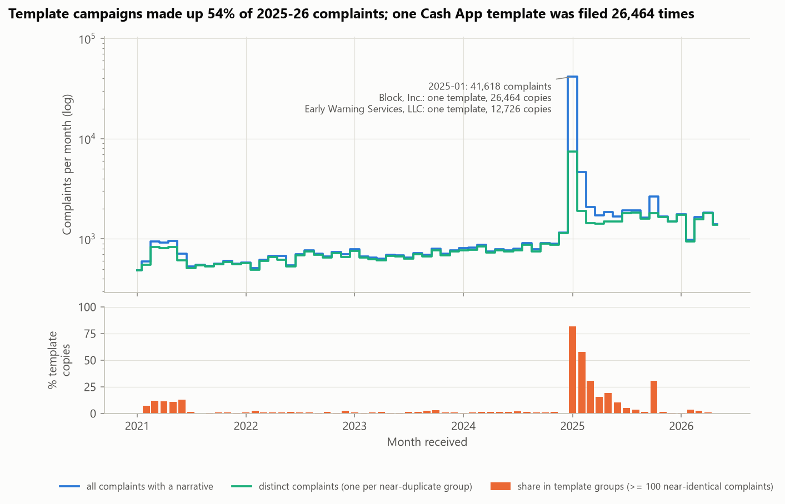
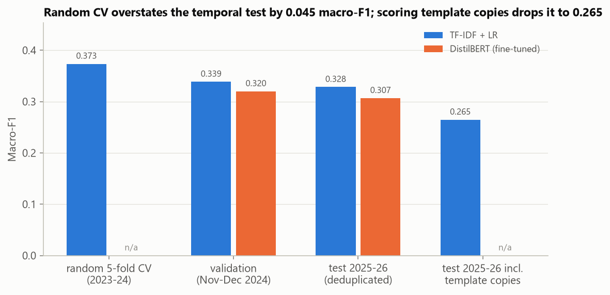
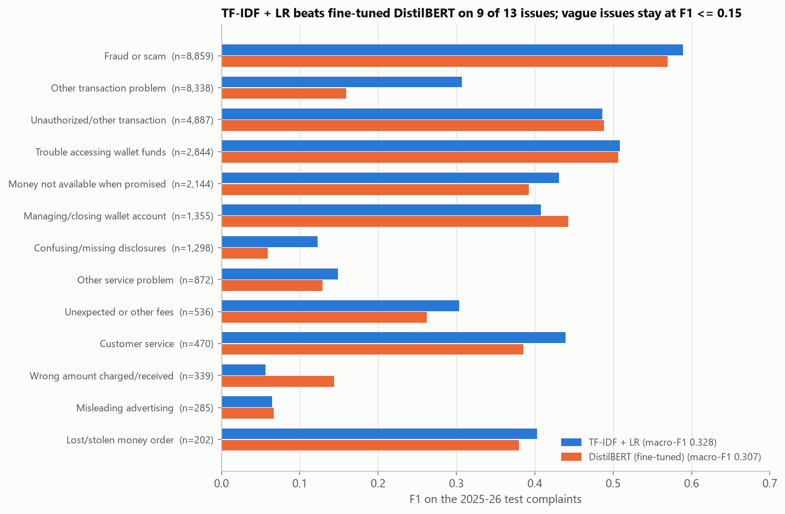
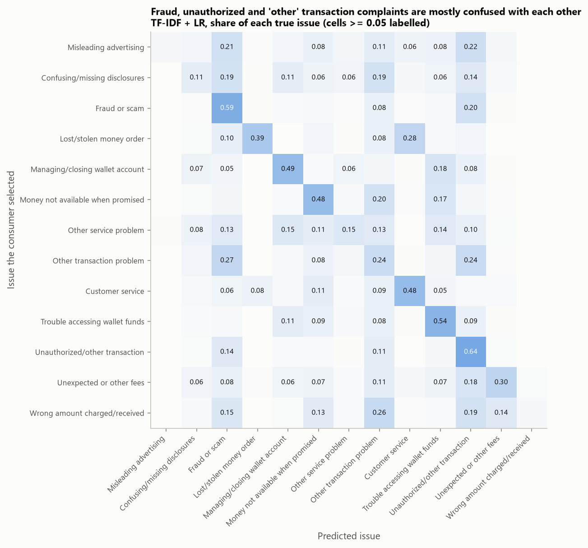
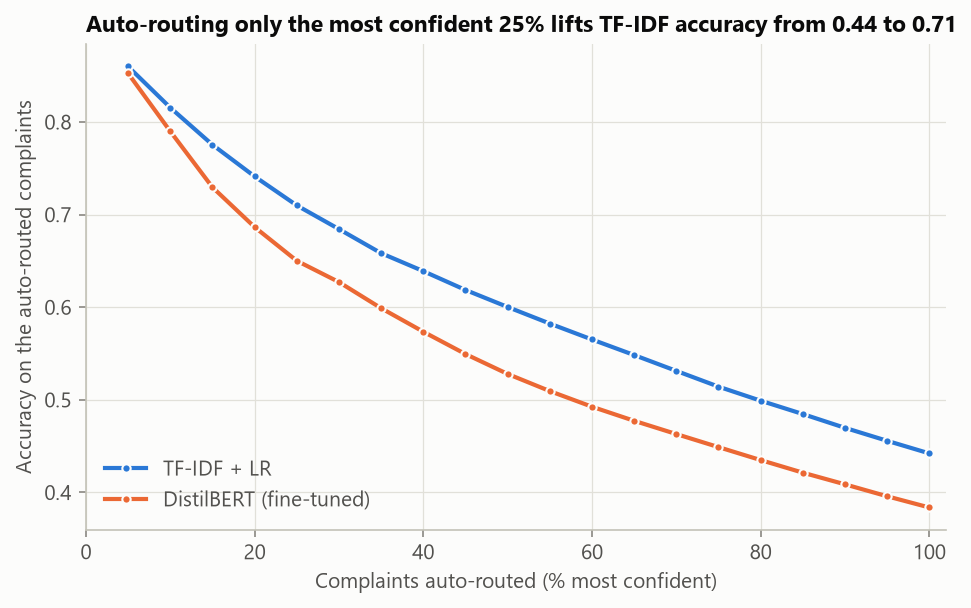
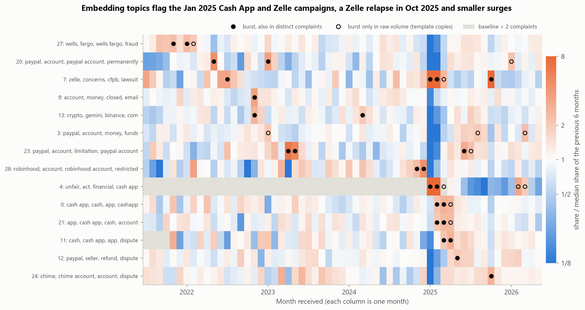
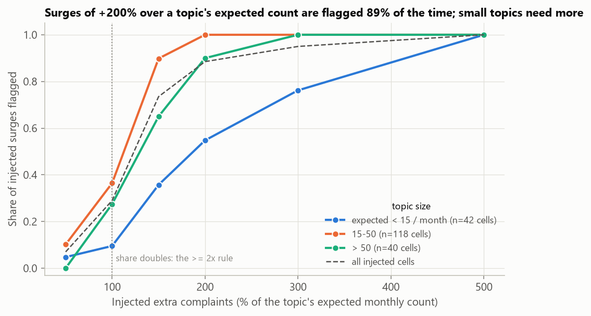
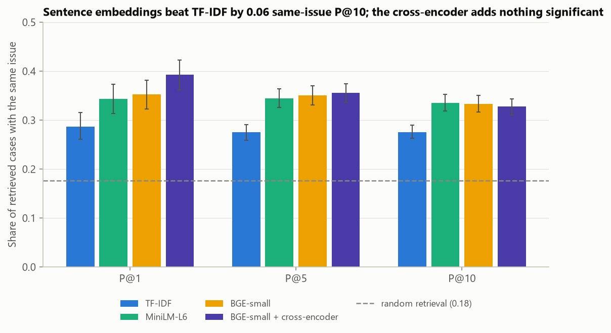

# Fintech Complaint Intelligence

[](https://github.com/ChetanYarlagadda/cfpb-complaint-intelligence/actions/workflows/ci.yml)

**Can a payments company's complaint team route, monitor and search consumer complaints automatically, and what
gets in the way?** This project builds and evaluates the three tools such a team needs on 107,066 real complaints
about money transfers, payment apps and virtual currency filed with the U.S. Consumer Financial Protection Bureau
(CFPB): an issue router, an emerging-issue detector, and a similar-case search service.

It mirrors the customer-complaint NLP and case-search work of a fintech risk and operations team. Every model is
trained on older complaints and scored on later ones, each comparison gets a paired significance test, and the
detector is checked by injecting synthetic surges and seeing whether it finds them.



## Key findings

| Task | Baseline | Best | Validation |
|---|---|---|---|
| Issue routing (13 issues, 2025-26 test) | DistilBERT fine-tuned: macro-F1 0.307 | **TF-IDF + LR: 0.328** | temporal holdout, paired bootstrap |
| Emerging-issue detection | same test on CFPB issue labels: 11 flags, campaigns merged | **embedding topics: 38 flags, campaigns separated** | injection-recovery: +200% surges found 89% of the time |
| Similar-case search (same-issue P@10) | random 0.177, TF-IDF 0.276 | **MiniLM-L6: 0.335** (BGE-small 0.334) | 1,000 queries, Holm-corrected paired tests |

1. **Over half of recent complaints are template copies.** January 2025 brought 41,618 complaints, 82% of them
   copies: one Cash App (Block, Inc.) template was filed 26,464 times and one Zelle (Early Warning Services)
   template 12,726 times. Across January 2025 to May 2026, 54% of complaints sit in a near-duplicate group with at
   least 100 members. Everything downstream works on one complaint per group.
2. **A linear TF-IDF model routes better than fine-tuned DistilBERT.** Macro-F1 0.328 vs 0.307 (difference
   -0.022, 95% CI [-0.029, -0.014]). DistilBERT trails on narratives it reads in full as well as on truncated ones,
   so its 256-token window is not the reason. Absolute scores are low because consumers pick their own issue from
   overlapping categories; auto-routing only the most confident 25% lifts accuracy from 0.44 to 0.71.
3. **How the router is evaluated matters as much as which router it is.** Random 5-fold cross-validation inside
   the training years gives macro-F1 0.373, 0.045 above the temporal test. Scoring template copies as separate
   complaints drops macro-F1 to 0.265 and accuracy from 0.44 to 0.22.
4. **Text topics find surges the intake taxonomy hides.** The detector flags the Cash App template topic (23,807
   complaints against 24 expected) and the Zelle "concerns ... CFPB lawsuit" topic (13,696 against 798) in
   January 2025, a Zelle relapse in October 2025 (883 against 73), and smaller organic surges: Chime disputes
   (October 2025, 2.8x), restricted Robinhood accounts (December 2024, 4.4x) and PayPal account limitations (April
   2023, 6.5x). On the CFPB's own issue labels, January 2025 is just "Other transaction problem".
5. **A robust baseline is the difference between 38 and 142 alerts.** Comparing each month with the *median*
   share of the previous six months keeps the January 2025 flood from dragging every other topic's baseline down;
   with a pooled baseline the detector flags 142 topic-months, 122 of them in the six months after the flood.
6. **Embeddings beat TF-IDF for similar-case search; an off-the-shelf reranker doesn't help.** Same-issue P@10
   rises from 0.276 (TF-IDF) to 0.335 (MiniLM-L6), +0.059 (Holm p < 0.001). Reranking with the MS MARCO
   cross-encoder lifts P@1 from 0.353 to 0.393, which is not significant after Holm correction (p = 0.087), and
   leaves P@10 unchanged.

The data were checked against the official record first: 100 random complaints from the snapshot were looked up
in the live CFPB API and product, issue, company and date matched for all 100
([`live_api_crosscheck.csv`](reports/results/live_api_crosscheck.csv)).

## Results

### Template campaigns and deduplication

Complaints were grouped by MinHash near-duplicate detection (Jaccard >= 0.5 on word 5-shingles). The two largest
groups are the January 2025 templates above; the next ones are smaller recurring templates, such as a PayPal
account-closure text filed 474 times in 2021-2023 and two crypto-scam templates filed against Coinbase (257 and
108 copies)
([`near_duplicate_groups.csv`](reports/results/near_duplicate_groups.csv)). The MinHash estimates were checked
against exact Jaccard on 1,600 real pairs: mean error +0.005 inside groups, and none of 800 hard negatives (same
company and month, different group) reaches an exact Jaccard of 0.5 ([`minhash_check.csv`](reports/results/minhash_check.csv)).

Without this step, the test set would count one misrouted template thousands of times, the similar-case index
would return copies of the query, and the burst detector would chase one campaign for months.

### Routing: which issue queue?



| Model (test: Jan 2025 to May 2026, 32,429 complaints) | Macro-F1 | Accuracy | Top-2 accuracy | Validation macro-F1 (Nov-Dec 2024) |
|---|---:|---:|---:|---:|
| TF-IDF (1-2 grams) + logistic regression, C = 4 | **0.328** | **0.442** | **0.646** | **0.339** |
| DistilBERT-base-uncased, fine-tuned 2 epochs | 0.307 | 0.384 | 0.587 | 0.320 |

<sub>13 issues with at least 100 deduplicated training complaints; 4 rarer issues (204 training complaints) were
dropped ([`routing_dropped_issues.csv`](reports/results/routing_dropped_issues.csv)). Both models use class-balanced
weights. Difference DistilBERT - TF-IDF: -0.022, 95% paired-bootstrap CI [-0.029, -0.014], p < 0.001.</sub>



TF-IDF is ahead on 9 of 13 issues. Issues with a concrete vocabulary (fraud, wallet access, customer service,
lost money orders) reach F1 0.40-0.59; vague catch-all issues stay at or below 0.15 for both models. The confusion
matrix shows why the ceiling is low: "Fraud or scam", "Unauthorized transactions or other transaction problem" and
"Other transaction problem" describe the same events, and 27% of "Other transaction problem" complaints are
predicted as fraud.



**Is DistilBERT held back by truncation?** 28% of test narratives are longer than its 256-token window. It trails
TF-IDF on the narratives it reads in full (macro-F1 0.290 vs 0.310) by about as much as on the truncated ones
(0.347 vs 0.373), so truncation does not explain the gap ([`routing_by_length.csv`](reports/results/routing_by_length.csv)).
Validation macro-F1 barely moved between epoch 1 (0.318) and epoch 2 (0.320). A longer fine-tune, a larger model or
head-and-tail truncation might close the gap; they were outside this project's compute budget.



In operations a router does not have to decide every complaint. Sorting by the model's top probability,
TF-IDF is right on 71% of its most confident quarter and 60% of its most confident half.

### Emerging issues



Each row is one of the 14 (of 30) embedding topics with at least one burst; colour is the month's topic share
relative to its median share over the previous six months. Filled dots are bursts that also show up when every
near-duplicate group counts once; open dots are bursts carried by template copies alone
([`bursts.csv`](reports/results/bursts.csv)).

| Detector | Burst topic-months | In Feb-Jul 2025 (after the flood) |
|---|---:|---:|
| Median of the previous 6 monthly shares (used) | **38** | 15 |
| Pooled share of the previous 6 months | 142 | 122 |
| Same median test on the 17 CFPB issue labels | 11 | 2 |

The issue-label baseline flags January 2025 only as "Other transaction problem" (36,925 against 7,513 expected),
and flags "Trouble accessing funds in your mobile or digital wallet" in September-November 2023 because the
category itself first appears in the data then ([`issue_label_bursts.csv`](reports/results/issue_label_bursts.csv)).



To check sensitivity, 200 random quiet topic-months from 2022 onward received synthetic extra complaints (from +50%
to +500% of the expected count) and the detector was re-run each time. Surges of +200% are flagged 89% of the time,
+300% 95%; +100%, exactly the doubling rule, only 29%. Topics with fewer than 15 expected complaints a month need
larger surges because a burst also needs 30 complaints ([`burst_injection.csv`](reports/results/burst_injection.csv)).

### Similar-case search



| Method (1,000 queries from 2025-26, corpus of 17,707 complaints from 2023-24) | P@1 | P@5 | P@10 | Same sub-product P@10 |
|---|---:|---:|---:|---:|
| Random retrieval (label prior) | 0.177 | 0.177 | 0.177 | 0.279 |
| TF-IDF cosine | 0.287 | 0.275 | 0.276 | 0.438 |
| MiniLM-L6 + FAISS | 0.343 | 0.345 | **0.335** | 0.491 |
| BGE-small + FAISS | 0.353 | 0.350 | 0.334 | 0.478 |
| BGE-small, top 50 reranked by MS MARCO MiniLM cross-encoder | **0.393** | **0.356** | 0.328 | **0.500** |

<sub>A retrieved complaint counts as relevant when it has the query's issue label, a noisy proxy given the routing
results. Paired bootstrap and sign-flip tests with Holm correction over 6 comparisons
([`search_significance.csv`](reports/results/search_significance.csv)).</sub>

Both embedders beat TF-IDF by about 0.06 P@10 (Holm p < 0.001) and are indistinguishable from each other. The
cross-encoder was trained on web-search relevance, not complaint similarity, and does not help beyond the first hit.

### Entity extraction (spot check)

spaCy `en_core_web_sm` on 400 random test narratives, scored against structure the CFPB itself provides
([`entity_spotcheck.csv`](reports/results/entity_spotcheck.csv)):

| Entity | Check | Result |
|---|---|---:|
| MONEY | share of the CFPB's brace-wrapped amounts (`{$450.00}`) recovered | 1.00 |
| MONEY | share of extracted amounts that match a brace amount | 1.00 |
| DATE | narratives containing a redacted date (`XX/XX/XXXX`) | 0.46 |
| DATE | DATE entities that are those redacted dates | 0.00 |
| ORG | ORG entities that are only a redaction mark (`XXXX`) | 0.45 |
| ORG | narratives naming their company by brand (269) where an ORG entity names it | 0.45 |

Amounts are reliable; dates are redacted before publication, so DATE only returns relative phrases ("the same
day"); ORG needs post-filtering and a company alias list. This is a capability check without a hand-labelled gold
standard, not a benchmark.

## Data

| | |
|---|---|
| Source | [CFPB Consumer Complaint Database](https://www.consumerfinance.gov/data-research/consumer-complaints/), bulk export as of 2026-08-11, via the public-domain mirror [`vivekkopthsd/cfpb-consumer-complaints`](https://huggingface.co/datasets/vivekkopthsd/cfpb-consumer-complaints) (sha256 verified) |
| Product | "Money transfer, virtual currency, or money service" (domestic and international transfers, mobile and digital wallets, virtual currency, money orders, check cashing) |
| Rows used | 107,066 complaints with a consumer narrative, received 2021-01-01 to 2026-05-31; 65,494 near-duplicate groups |
| License | U.S. federal government work, public domain; the mirror is CC0-1.0 |

The live CFPB API and bulk export no longer include the narrative field (checked 2026-10-09), so this project uses
the last export that did. Narratives are published only when the consumer opts in, after the CFPB removes personal
information. The CFPB does not verify every allegation, and complaints are not a representative sample of consumers
or of market activity. The raw parquet (~1 GB) is downloaded to `data/raw/` and not redistributed here.

Models, all from the Hugging Face Hub:
[distilbert-base-uncased](https://huggingface.co/distilbert-base-uncased),
[all-MiniLM-L6-v2](https://huggingface.co/sentence-transformers/all-MiniLM-L6-v2),
[bge-small-en-v1.5](https://huggingface.co/BAAI/bge-small-en-v1.5),
[ms-marco-MiniLM-L-6-v2](https://huggingface.co/cross-encoder/ms-marco-MiniLM-L-6-v2); and spaCy
[en_core_web_sm 3.8.0](https://github.com/explosion/spacy-models).

## Method

- **Cleaning.** Narratives keep their text; for modelling, the CFPB's redaction marks (`XXXX`, `XX/XX/XXXX`) are
  removed and amounts lose their braces.
- **Near-duplicates.** MinHash with 128 affine hash functions over word 5-shingles, LSH with 32 bands of 4 rows,
  and each LSH bucket verified against its first member. The share of agreeing signature slots estimates
  Jaccard similarity, `J(A, B) = |A ∩ B| / |A ∪ B|`; pairs with an estimate >= 0.5 are joined (union-find).
- **Routing.** Temporal split: train 2023-01-01 to 2024-11-08, validation 2024-11-08 to 2024-12-31 (the latest 10%
  of the training period), test 2025-01-01 to 2026-05-31, one complaint per near-duplicate group, and test complaints whose group
  appeared earlier removed. TF-IDF (1-2 grams, sublinear tf, 200k features) + multinomial logistic regression with
  `C` chosen on validation from {1, 4, 16}. DistilBERT: max 256 tokens, 2 epochs, batch 32, AdamW (lr 5e-5, 6%
  warmup), fp16, class-weighted cross-entropy, best epoch kept by validation macro-F1.
- **Topics.** One MiniLM-L6 embedding per near-duplicate group, mini-batch k-means with k = 30, labels by class-based
  TF-IDF as in BERTopic: `W(t, c) = tf(t, c) / |c| · log(1 + A / f(t))`.
- **Bursts.** For topic `c` in month `t`, `expected = N_t · median(share_c over t-6 .. t-1)` and
  `p = P(X >= x_ct)` with `X ~ Binomial(N_t, p̂)`. A burst needs Benjamini-Hochberg q < 0.01 across all
  topic-months, observed/expected >= 2 and at least 30 complaints. The thresholds were fixed before the first run;
  the median baseline replaced a pooled one after that run showed the flood artifact, and both are reported.
- **Search.** Exact cosine search with FAISS (`IndexFlatIP`) on normalised embeddings (max 256 tokens, no query
  prefix, since complaint-to-complaint similarity is symmetric); cross-encoder reranking of the top 50.
- **Statistics.** Paired bootstrap CIs (2,000 resamples for macro-F1 and the P@k intervals, 10,000 for the paired
  search tests), sign-flip randomisation tests, Holm correction across the search comparisons.
- **Tracking.** Every routing, search and detector configuration is logged as an MLflow run (local SQLite store in
  `mlruns/`, git-ignored); summary tables are committed under [`reports/results/`](reports/results/).

## Validation and limitations

- **Labels are noisy.** The issue is chosen by the consumer from overlapping categories, so routing scores and the
  same-issue relevance proxy for search are both capped well below 1. The ranking of methods is more trustworthy
  than the absolute numbers.
- **One snapshot, one product family.** All results come from the last public export with narratives (2026-08-11)
  and from one CFPB product. Narratives exist only for consumers who opted in, a self-selected subset.
- **Near-duplicate threshold.** Jaccard >= 0.5 groups lightly edited template copies but not heavily personalised
  ones, so "distinct complaints" overstates organic volume and the 54% template share is a lower bound. The MinHash
  hash is accurate on real complaints (checked) but is not a strong mixing hash; on synthetic text where every token
  is new it is biased.
- **Routing model budget.** DistilBERT was fine-tuned once (2 epochs, 256 tokens, no hyperparameter search) to keep
  GPU use to a few minutes. ModernBERT, which the original plan included, was not trained. TF-IDF + LR had a
  3-value grid for `C`. A larger budget could change the routing comparison.
- **Topic model choices.** k = 30 was fixed, not tuned, and k-means replaces BERTopic's UMAP + HDBSCAN. Burst
  thresholds were set a priori; the injection test adds counts to the monthly matrix rather than new texts, so it
  checks the test statistic, not the embedding step.
- **Similar-case relevance.** Same-issue precision says nothing about whether a retrieved case is actually useful
  to an analyst. The cross-encoder is a web-search model; one fine-tuned on complaint pairs might behave differently.
- **NER.** A 400-document automatic spot check of the small spaCy model, not a gold-standard evaluation.

## Reproduce

```bash
pip install torch --index-url https://download.pytorch.org/whl/cu128   # or the CPU build
pip install -r requirements.txt
python scripts/run_pipeline.py            # full run: about 20 min on a laptop GPU (RTX 4050); downloads ~1 GB once
python scripts/run_pipeline.py --quick    # smoke test on 6,000 complaints: outputs go to data/cache/smoke/
python scripts/make_figures.py            # redraw figures from reports/results/
pytest
```

Every expensive intermediate (MinHash signatures, embeddings, fine-tuned weights, predictions, cross-encoder
rankings, live-API responses) is cached in `data/cache/` under a key that includes its settings, so re-runs only
recompute what changed.

Serve the router and similar-case search as an API (needs the artifacts from a pipeline run):

```bash
uvicorn app.main:app --port 8000        # Swagger UI at http://localhost:8000/docs
curl -X POST localhost:8000/route -H "Content-Type: application/json" \
     -d '{"text": "I sent $450 through Zelle to pay for a puppy advertised online and the seller disappeared.", "k": 3}'
curl -X POST localhost:8000/similar -H "Content-Type: application/json" \
     -d '{"text": "Cash App closed my account and is holding my balance.", "k": 5, "rerank": false}'
```

`COMPLAINTIQ_ROUTER=distilbert` switches the router to the fine-tuned model and `COMPLAINTIQ_RERANKER=0` skips
loading the cross-encoder. In an in-process check ([`scripts/api_smoke.py`](scripts/api_smoke.py),
[`api_smoke.json`](reports/results/api_smoke.json)) the median latency was 1.4 ms for `/route`, 14 ms for
`/similar` and 52 ms for `/similar` with reranking of the top 20 (RTX 4050 laptop).

## Project structure

```
complaintiq/
  data.py         snapshot download + checksum, product/date filtering, text cleaning, live-API cross-check
  dedup.py        MinHash + LSH near-duplicate groups, accuracy check against exact Jaccard
  routing.py      temporal splits without group leakage, TF-IDF + LR, risk-coverage
  finetune.py     DistilBERT fine-tuning and inference (fp16, length-bucketed batches, cached)
  embeddings.py   Sentence Transformers bi-encoders and the cross-encoder, cached embeddings
  search.py       TF-IDF / FAISS search, reranking, precision@k
  emerging.py     k-means topics, c-TF-IDF labels, binomial burst test, injection-recovery
  entities.py     spaCy ORG / MONEY / DATE extraction and the automatic spot check
  stats.py        macro-F1, paired bootstrap, randomisation test, Holm and Benjamini-Hochberg
  tracking.py     MLflow logging
  figures.py      all report figures
  plotting.py     shared colorblind-safe styling
app/              FastAPI + Pydantic service (/route, /similar)
scripts/          run_pipeline.py (all experiments), make_figures.py, api_smoke.py
notebooks/        analysis.ipynb, the full walkthrough with tables
reports/          figures/ and results/ (every number quoted above)
tests/            pytest suite (dedup, bursts, statistics, routing splits, search, entities, API)
```

## License

MIT; see [LICENSE](LICENSE). The CFPB data are in the public domain; models keep their own licenses.
